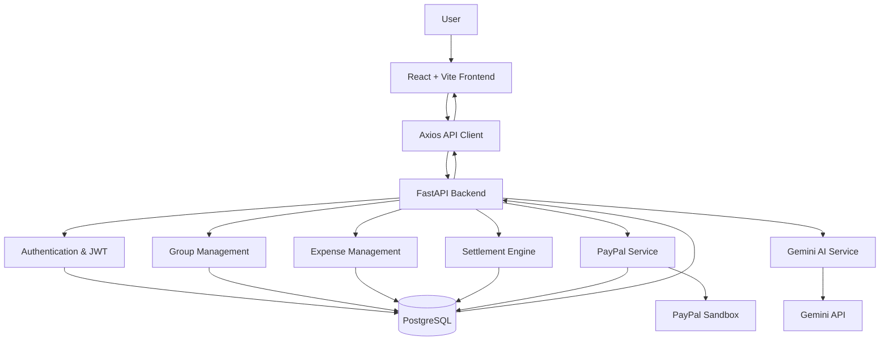
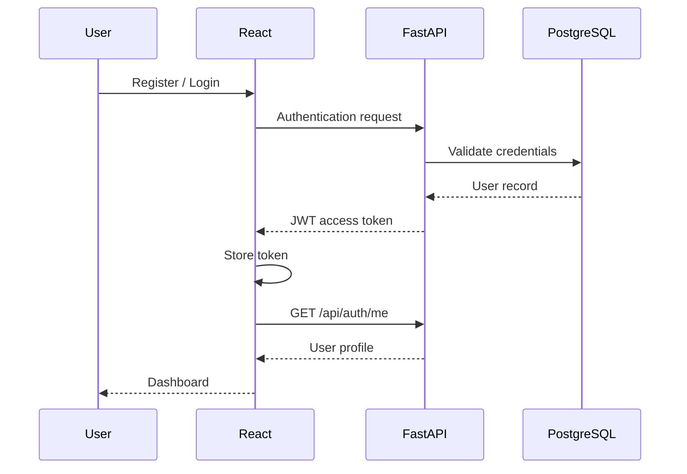
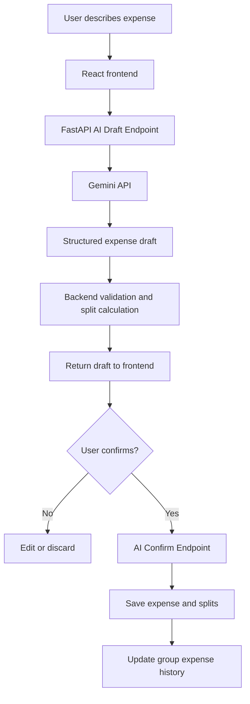
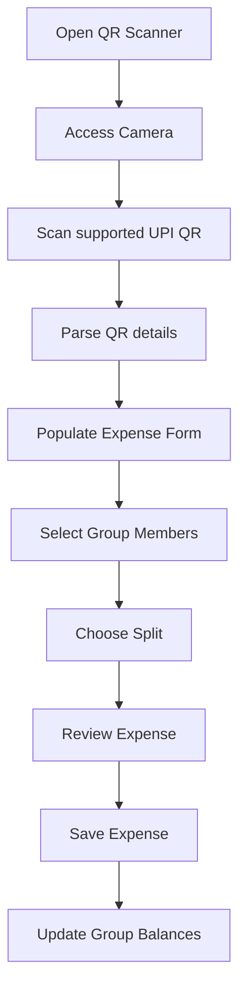
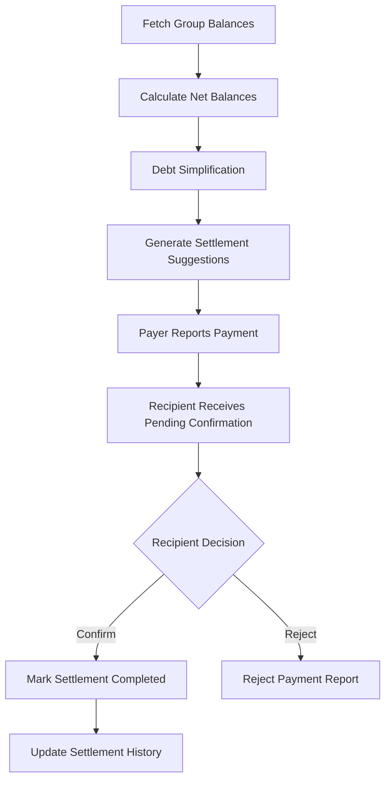

# 💸 PayEase — Split Smart. Settle Simply.

**Group expenses, AI-powered expense tracking, intelligent splitting and seamless merchant checkout — all in one place.**

[](https://react.dev/)
[](https://fastapi.tiangolo.com/)
[](https://www.postgresql.org/)
[](https://www.python.org/)
[](https://developer.paypal.com/)
[](https://ai.google.dev/)

---

## 🌟 Overview

Managing shared expenses should be the easiest part of spending time with friends. Yet, keeping track of who paid, calculating everyone's share, remembering pending payments and coordinating settlements can quickly become frustrating.

Traditional expense-splitting workflows involve manually entering transactions, calculating individual contributions, maintaining spreadsheets and repeatedly reminding people to settle their dues.

**PayEase eliminates this friction by bringing the entire group-expense lifecycle into one intelligent application.**

From scanning a payment QR code and generating an expense using natural language to calculating individual shares and simplifying outstanding debts, PayEase makes shared spending more organised and transparent.

Instead of manually figuring out who owes whom, users can focus on what matters while PayEase takes care of the numbers.

### The idea

> Spend together. Split intelligently. Settle without the hassle.

---

## 🎯 The Problem

When multiple people share expenses, several problems arise:

- **Manual expense tracking:** Someone has to remember every transaction and record it.
- **Calculation overhead:** Unequal contributions and different splitting arrangements make calculations tedious.
- **Scattered information:** Expense details, payment screenshots and pending dues are spread across chats and notes.
- **Settlement confusion:** People often struggle to determine the minimum number of payments required to clear group balances.
- **Repeated coordination:** Reminding members about pending payments creates unnecessary friction.
- **Payment workflow fragmentation:** Recording an expense, making a merchant payment and tracking group settlements are often disconnected activities.

## 💡 Our Solution

PayEase provides a centralised platform where users can:

1. Create groups or join existing groups through unique invite codes.
2. Record expenses manually or scan QR codes.
3. Use AI to convert natural-language expense descriptions into structured expense drafts.
4. Split expenses equally or according to individual contributions.
5. Track how much each member has paid and owes.
6. Simplify group debts into fewer settlement transactions.
7. Report payments and let recipients acknowledge them.
8. Experience merchant checkout through PayPal Sandbox.

---

# ✨ Key Features

## 1. 👥 Group Management

Organise shared spending around groups of friends, roommates, trips, events or any other shared activity.

- Create groups with a name and description.
- Join groups using unique invite codes.
- View group members and their roles.
- Add existing registered users through their email addresses.
- Manage group membership.
- View group-specific expenses, balances and settlement history.

**Invite-code system:** Every group receives a unique eight-character alphanumeric invite code, making it easy for members to join without manually adding everyone.

## 2. 📸 QR-Based Expense Entry

Avoid manually entering every detail of a merchant transaction.

PayEase includes a camera-based QR scanner that:

- Accesses the device camera.
- Scans supported UPI payment QR codes.
- Extracts available QR information.
- Parses relevant details such as merchant information and amount, when present.
- Populates the expense-entry workflow.
- Allows users to select participants and split the expense.

Users can review and complete the expense details before saving.

**Important:** Scanning a QR code extracts payment information; it does not independently verify that a bank transaction has occurred.

## 3. 🤖 AI-Powered Expense Drafting

Expense recording becomes easier with natural-language input.

PayEase integrates Google's Gemini API to transform user-provided expense descriptions into structured expense drafts.

For example, a user can describe an expense in natural language:

> "We spent $120 on dinner. Alice paid, and the expense should be shared equally among Alice, Bob and Charlie."

The AI expense-processing pipeline extracts relevant information, including:

- Total expense amount.
- Expense description.
- Merchant information, when provided.
- Participants.
- Individual shares.
- Item-level information, when applicable.
- Suggested split details.

### How the AI workflow operates

1. The user submits an expense description.
2. The backend sends the input to the Gemini model.
3. Gemini generates structured expense data.
4. The backend validates and processes the generated draft.
5. The calculated shares and participant information are prepared.
6. The draft is returned to the frontend for review.
7. The user confirms the expense.
8. The confirmed expense is persisted in PostgreSQL.

**Why draft-and-confirm?**

AI-generated information should not automatically become a financial record without user review. PayEase keeps generation and persistence separate, giving users control over the final expense.

## 4. ⚖️ Flexible Expense Splitting

Different expenses require different splitting arrangements.

PayEase supports multiple splitting strategies through its expense data model:

| Split type | Description |
|---|---|
| Equal | Divide the expense equally among participants. |
| Manual | Specify each participant's share. |
| Additional amount | Account for additional individual contributions. |
| Percentage | Allocate shares using percentages. |
| Ratio | Divide according to specified ratios. |
| Custom | Support customised participant allocations. |
| Itemised | Associate expenses with individual items. |

Each expense stores its participant information and corresponding share amounts.

The system maintains the relationship between the total expense, the payer and each participant's allocated share.

## 5. 📊 Intelligent Balance Calculation

PayEase maintains a group-level financial overview.

For every member, the system tracks:

- Total amount paid.
- Total expense share.
- Net balance.

The net balance is calculated as:

**Net Balance = Total Paid − Total Share**

Interpretation:

- Positive balance: The member is owed money.
- Negative balance: The member owes money.
- Zero balance: The member is settled.

The dashboard and group details page provide visibility into these balances.

## 6. 🔄 Debt Simplification Algorithm

One of PayEase's important capabilities is reducing the number of transactions required to settle group expenses.

Consider a group where several members owe money while others are owed money.

Rather than asking every debtor to pay every creditor individually, PayEase calculates net balances and generates a simplified settlement plan.

### Example

Suppose a group has these balances:

| Member | Net balance |
|---|---:|
| Alice | +$100 |
| Bob | -$60 |
| Charlie | -$40 |

Instead of multiple unnecessary transfers, the system generates:

- Bob pays Alice $60.
- Charlie pays Alice $40.

The group reaches a zero net balance using only two transactions.

### How it works

1. Retrieve the net balance of every group member.
2. Separate members with positive balances from those with negative balances.
3. Match debtors with creditors.
4. Calculate the minimum amount needed for each matched transaction.
5. Update the remaining balances.
6. Continue until all balances are settled.

This greedy debt-settlement approach reduces unnecessary payment interactions while preserving the group's overall financial balance.

## 7. 💳 Settlement Tracking and Confirmation

PayEase provides a structured settlement workflow.

- Generate simplified settlement suggestions.
- Identify who needs to pay whom.
- Allow the payer to report a payment.
- Notify the recipient through the application's pending-confirmation workflow.
- Allow the recipient to confirm or reject the reported payment.
- Track pending and completed settlement records.
- Maintain settlement history.

The payer and recipient have different responsibilities, ensuring that a reported payment is not automatically treated as completed without acknowledgement.

**Payment integrity:** This is a user-reported payment and recipient-acknowledgement workflow. It does not independently verify a bank transfer.

## 8. 🅿️ PayPal Sandbox Integration

PayPal integration is an important part of PayEase's payment demonstration.

The application integrates PayPal Sandbox to demonstrate a merchant checkout lifecycle.

### Implemented payment flow

1. The user initiates a merchant checkout.
2. The React frontend sends the payment request to FastAPI.
3. The backend validates group membership.
4. The backend creates a PayPal order.
5. A pending payment transaction is recorded in PostgreSQL.
6. The approval URL is returned to the frontend.
7. The user is redirected to PayPal Sandbox.
8. The user approves the payment using a Sandbox buyer account.
9. PayPal redirects the user to the backend return endpoint.
10. The backend redirects the user to the appropriate frontend page.
11. The frontend initiates the capture request.
12. The backend captures the approved PayPal order.
13. The transaction is marked completed only when PayPal confirms a `COMPLETED` status.
14. The capture ID and provider response are stored in the payment transaction record.

### Transaction management

The payment transaction stores relevant information such as:

- Group ID.
- Payer user ID.
- Payment provider.
- Provider order ID.
- Provider capture ID.
- Idempotency key.
- Amount and currency.
- Transaction status.
- Provider response data.

### Important distinction

PayEase maintains two separate payment-related workflows:

**Merchant checkout:** Actual PayPal Sandbox order creation, approval and capture.

**Group settlement:** A settlement suggestion followed by payment reporting and recipient acknowledgement.

These are deliberately kept separate. The current implementation does not claim to provide verified PayPal person-to-person transfers between group members.

---

# 🏗️ System Architecture

PayEase follows a client-server architecture with a React frontend, FastAPI backend and PostgreSQL database.

### High-level architecture



### Component responsibilities

| Component | Responsibility |
|---|---|
| React frontend | User interface and application interactions |
| React Router | Navigation and protected routes |
| Axios | Communication with backend APIs |
| FastAPI | REST API and business logic |
| SQLAlchemy | Database interaction and ORM |
| PostgreSQL | Persistent application data |
| Alembic | Database schema migrations |
| Gemini API | Natural-language expense parsing |
| PayPal Sandbox | Merchant payment checkout demonstration |
| AG Grid | Transaction dashboard and data presentation |

## 🔁 Core Application Workflows

### A. User authentication



### B. Expense creation using AI



### C. QR expense workflow



### D. Settlement workflow



---

# 🧰 Technology Stack

## Frontend

| Technology | Usage |
|---|---|
| React | Component-based user interface |
| Vite | Development server and production build |
| Tailwind CSS | Styling and responsive layouts |
| React Router | Client-side navigation |
| Axios | HTTP requests |
| AG Grid Community | Transaction dashboard |
| Browser Camera APIs / QR scanning integration | QR-based expense capture |

## Backend

| Technology | Usage |
|---|---|
| Python | Backend programming language |
| FastAPI | REST API framework |
| Pydantic | Request validation and settings management |
| SQLAlchemy | ORM and database operations |
| Alembic | Database migrations |
| PostgreSQL | Relational database |
| PyJWT | JWT authentication |
| Gemini API | AI expense parsing |
| PayPal Sandbox | Payment-provider integration |

## Deployment

| Service | Purpose |
|---|---|
| Render PostgreSQL | Hosted database |
| Render Web Service | FastAPI backend |
| Render Static Site | React frontend |

---

# 🗄️ Database Design

PayEase uses PostgreSQL to maintain relational consistency across users, groups, expenses, splits, settlements and payment transactions.

### Core entities

| Entity | Purpose |
|---|---|
| User | Stores registered user information and account details. |
| Group | Stores group information, invite codes and configuration. |
| GroupMember | Maintains group membership and roles. |
| Expense | Stores expense details, payer, amount and source. |
| ExpenseSplit | Stores each participant's share of an expense. |
| Settlement | Stores suggested and tracked settlement transactions. |
| PaymentTransaction | Stores PayPal order and capture information. |
| SettlementPayment | Stores reported settlement payments and confirmation status. |

### Important expense fields

The expense model supports fields such as:

- `group_id`
- `paid_by`
- `amount`
- `description`
- `merchant`
- `input_source`
- `transcription_text`
- `split_type`
- `expense_date`

Each expense is associated with its corresponding expense splits.

### Expense input sources

The expense schema distinguishes between:

- `manual`
- `qr`
- `voice`
- `ai`

This allows the application to identify how an expense was entered.

---

# 📁 Project Structure

The following is a representative structure of the application. Some filenames may differ in the current repository.

```text
PayEase/
│
├── frontend/
│   ├── public/
│   │
│   ├── src/
│   │   ├── components/
│   │   │   ├── Navbar.jsx
│   │   │   ├── AuthForm.jsx
│   │   │   ├── AuthToggle.jsx
│   │   │   └── ...
│   │   │
│   │   ├── context/
│   │   │   └── AuthContext.jsx
│   │   │
│   │   ├── lib/
│   │   │   └── api.js
│   │   │
│   │   ├── pages/
│   │   │   ├── Dashboard.jsx
│   │   │   ├── Auth.jsx
│   │   │   ├── GroupDetails.jsx
│   │   │   ├── QRScanner.jsx
│   │   │   ├── Settlements.jsx
│   │   │   └── ProfileSettings.jsx
│   │   │
│   │   ├── App.jsx
│   │   └── main.jsx
│   │
│   ├── package.json
│   ├── vite.config.js
│   └── index.html
│
└── backend/
    ├── app/
    │   ├── core/
    │   │   ├── config.py
    │   │   ├── dependencies.py
    │   │   └── security.py
    │   │
    │   ├── database/
    │   │   └── connection.py
    │   │
    │   ├── models/
    │   │   ├── user.py
    │   │   ├── group.py
    │   │   ├── group_member.py
    │   │   ├── expense.py
    │   │   ├── expense_split.py
    │   │   ├── settlement.py
    │   │   └── payment_transaction.py
    │   │
    │   ├── routes/
    │   │   ├── auth.py
    │   │   ├── groups.py
    │   │   ├── expenses.py
    │   │   ├── settlements.py
    │   │   └── settlement_payments.py
    │   │
    │   ├── schemas/
    │   ├── services/
    │   │   └── paypal_service.py
    │   │
    │   └── main.py
    │
    ├── alembic/
    │   └── versions/
    │
    ├── alembic.ini
    └── requirements.txt
```

---

# ⚙️ Getting Started

Follow these instructions to run PayEase locally.

## Prerequisites

Install the following:

- Node.js and npm
- Python 3.10 or later
- PostgreSQL
- Git

You will also need:

- A Gemini API key.
- PayPal Sandbox application credentials.

## 1. Clone the repository

```bash
git clone <YOUR_GITHUB_REPOSITORY_URL>
cd PayEase
```

## 2. Backend setup

Navigate to the backend directory:

```bash
cd backend
```

Create a Python virtual environment:

```bash
python -m venv venv
```

Activate it on Windows:

```powershell
.\venv\Scripts\Activate.ps1
```

On macOS/Linux:

```bash
source venv/bin/activate
```

Install dependencies:

```bash
pip install -r requirements.txt
```

## 3. Configure backend environment variables

Create a `.env` file inside the backend directory.

```env
# PostgreSQL Configuration
DB_USER=your_database_username
DB_PASSWORD=your_database_password
DB_HOST=localhost
DB_PORT=5432
DB_NAME=payease

# Authentication
SECRET_KEY=your_secure_secret_key
ALGORITHM=HS256
ACCESS_TOKEN_EXPIRE_MINUTES=60

# Gemini Configuration
GEMINI_API_KEY=your_gemini_api_key
GEMINI_MODEL=gemini-2.5-flash-lite

# PayPal Sandbox
PAYPAL_CLIENT_ID=your_paypal_sandbox_client_id
PAYPAL_CLIENT_SECRET=your_paypal_sandbox_secret
PAYPAL_BASE_URL=https://sandbox.paypal.com

# Application URLs
FRONTEND_URL=http://localhost:5173
BACKEND_URL=http://localhost:8000
```

Replace the placeholders with your own credentials.

**Never commit `.env` files or expose API keys, database credentials or JWT secrets in the repository.**

## 4. Database migrations

Make sure PostgreSQL is running and the configured database exists.

Apply migrations:

```bash
alembic upgrade head
```

This creates or updates the database schema according to the Alembic migration history.

## 5. Start the backend

From the backend directory:

```bash
uvicorn app.main:app --reload
```

The backend will be available at:

```text
http://localhost:8000
```

FastAPI interactive documentation:

```text
http://localhost:8000/docs
```

## 6. Frontend setup

Open another terminal and navigate to the frontend directory:

```bash
cd frontend
```

Install dependencies:

```bash
npm install
```

Create a `.env` file:

```env
VITE_API_URL=http://localhost:8000
```

Start the development server:

```bash
npm run dev
```

The frontend will generally be available at:

```text
http://localhost:5173
```

---

# 🔌 API Overview

The backend exposes REST APIs through FastAPI.

The following table summarises the main API groups and endpoints implemented in the application.

## Authentication

| Method | Endpoint | Purpose |
|---|---|---|
| POST | `/api/auth/register` | Register a new user |
| POST | `/api/auth/login` | Authenticate a user |
| GET | `/api/auth/me` | Retrieve current user profile |
| PATCH | `/api/auth/me` | Update supported profile settings |

## Groups

| Method | Endpoint | Purpose |
|---|---|---|
| POST | `/api/groups/` | Create a group |
| GET | `/api/groups/` | Retrieve user's groups |
| GET | `/api/groups/{group_id}` | Retrieve group details |
| GET | `/api/groups/{group_id}/members` | Retrieve group members |
| POST | `/api/groups/{group_id}/members` | Add an existing user |
| DELETE | `/api/groups/{group_id}/members/{user_id}` | Remove a member |
| PATCH | `/api/groups/{group_id}` | Update group details |
| DELETE | `/api/groups/{group_id}/leave` | Leave a group |
| POST | `/api/groups/join` | Join using an invite code |
| GET | `/api/groups/{group_id}/balances` | Retrieve member balances |

## Expenses

| Method | Endpoint | Purpose |
|---|---|---|
| POST | `/api/groups/{group_id}/expenses/` | Create an expense |
| GET | `/api/groups/{group_id}/expenses/` | List group expenses |
| GET | `/api/groups/{group_id}/expenses/{expense_id}` | Retrieve expense details |
| PUT | `/api/groups/{group_id}/expenses/{expense_id}` | Update an expense |
| DELETE | `/api/groups/{group_id}/expenses/{expense_id}` | Delete an expense |
| POST | `/api/groups/{group_id}/expenses/ai-draft` | Generate an AI expense draft |
| POST | `/api/groups/{group_id}/expenses/ai-confirm` | Confirm and save an AI draft |

## PayPal

| Method | Endpoint | Purpose |
|---|---|---|
| POST | `/api/paypal/create-order` | Create a PayPal order |
| POST | `/api/paypal/capture-order/{order_id}` | Capture an approved order |
| GET | `/api/paypal/return` | Handle PayPal approval return |
| GET | `/api/paypal/cancel` | Handle checkout cancellation |
| GET | `/api/paypal/test` | Check PayPal credential configuration |
| GET | `/api/paypal/token-test` | Test PayPal Sandbox authentication |

## Settlement Payments

The settlement-payment workflow provides endpoints for reporting payments, retrieving pending recipient confirmations and confirming or rejecting reported payments.

For exact request and response schemas, refer to the FastAPI Swagger documentation at `/docs`.

---

# 🔐 Security and Data Integrity

PayEase incorporates several application-level security practices:

### Authentication

- JWT-based authentication.
- Protected backend endpoints.
- Authenticated user identification through request dependencies.
- Token-based frontend authentication.

### Group access control

- Group membership validation.
- Role-based restrictions for supported group-management actions.
- Ownership checks for payment transactions.
- Validation before accessing or modifying group resources.

### Payment safety

- PayPal credentials stored in environment variables.
- Payment transactions persisted in PostgreSQL.
- Capture requests associated with the authenticated payer.
- Duplicate capture attempts guarded through transaction status checks.
- Transactions marked completed only after PayPal reports successful completion.

### Data validation

- Pydantic request schemas.
- SQLAlchemy relational models.
- Database migrations through Alembic.
- Validation of expense participants and split information.

---

# ☁️ Deployment on Render

PayEase uses a three-service deployment architecture.

```text
                   INTERNET
                       |
              React Frontend
               Render Static
                       |
                  HTTPS API
                       |
              FastAPI Backend
               Render Web
                       |
                PostgreSQL
               Render Database
```

## Frontend deployment

Create a Render Static Site.

| Setting | Value |
|---|---|
| Root Directory | Frontend project directory |
| Build Command | `npm install && npm run build` |
| Publish Directory | `dist` |

Environment variable:

```env
VITE_API_URL=https://YOUR-BACKEND-URL.onrender.com
```

## Backend deployment

Create a Render Web Service.

| Setting | Value |
|---|---|
| Root Directory | `backend` |
| Build Command | `pip install -r requirements.txt` |
| Start Command | `alembic upgrade head && uvicorn app.main:app --host 0.0.0.0 --port $PORT` |

Configure the backend environment variables using the same names as the local `.env` file, replacing local database credentials and application URLs with production values.

The backend also requires:

```env
FRONTEND_URL=https://YOUR-FRONTEND-URL.onrender.com
BACKEND_URL=https://YOUR-BACKEND-URL.onrender.com
```

## CORS configuration

The backend must explicitly allow the deployed frontend origin.

```python
app.add_middleware(
    CORSMiddleware,
    allow_origins=[
        settings.FRONTEND_URL,
        "http://localhost:5173",
    ],
    allow_credentials=True,
    allow_methods=["*"],
    allow_headers=["*"],
)
```

## Database deployment

Create a Render PostgreSQL database and configure the backend with its connection details.

Use the Internal Database URL's components for:

- `DB_USER`
- `DB_PASSWORD`
- `DB_HOST`
- `DB_PORT`
- `DB_NAME`

The backend and database should be configured in the same Render region when using the internal connection.

**Migration note:** Alembic applies pending schema migrations to the existing database. Do not recreate the production database for routine schema changes.

---

# 🧪 Testing and Verification

Before considering a deployment complete, verify the following.

| Area | Test |
|---|---|
| Backend | `/api/health` returns a successful response |
| Database | `/api/db-test` confirms database connectivity |
| Authentication | Registration, login and token persistence |
| Groups | Create, list and join groups |
| Invite codes | Verify valid, invalid and duplicate join attempts |
| Expenses | Create and retrieve expenses |
| Splitting | Verify participant shares and totals |
| QR scanner | Scan supported QR codes and review parsed details |
| AI | Generate, edit and confirm expense drafts |
| Balances | Check net balances across group members |
| Settlements | Generate plans and test recipient confirmation |
| PayPal | Create, approve, return and capture a Sandbox order |
| Deployment | Verify CORS, frontend routes and backend logs |

---

# ⚠️ Current Scope and Limitations

PayEase is developed as a hackathon MVP. The following distinctions are important:

1. **PayPal Sandbox:** The payment-provider integration uses Sandbox credentials and test accounts. It is not a production merchant-payment deployment.
2. **Member settlement:** Settlement reporting and recipient acknowledgement are separate from PayPal merchant checkout.
3. **Bank transfer verification:** QR scanning and settlement acknowledgement do not independently verify real bank transfers.
4. **Currency:** The current demonstration configuration uses USD.
5. **AI accuracy:** AI-generated expense details should be reviewed by users before confirmation.
6. **External services:** AI and payment functionality depend on the availability and configuration of their respective providers.
7. **Production readiness:** Deployment does not replace full security, reliability and end-to-end testing.

---

# 🚀 Future Enhancements

Potential directions for extending PayEase include:

- Stronger payment-provider integrations and verified payment reconciliation.
- More detailed transaction analytics and spending insights.
- Recurring expenses and automated reminders.
- Improved voice-based expense entry and transcription.
- Receipt image extraction and OCR.
- Multi-currency support.
- Expense export and downloadable reports.
- Enhanced notifications and activity tracking.
- More advanced settlement optimisation.
- Comprehensive automated testing and monitoring.

---

# 💛 Why PayEase?

PayEase is built around a simple idea: managing shared expenses should not become another task people have to worry about.

By combining group management, QR-based entry, AI-assisted expense drafting, flexible splitting, debt simplification and payment-provider integration, PayEase brings multiple stages of shared spending into one connected workflow.

**Less manual tracking. Fewer calculations. Clearer settlements. More time for the moments that matter.**

### PayEase — Split Smart. Settle Simply.
